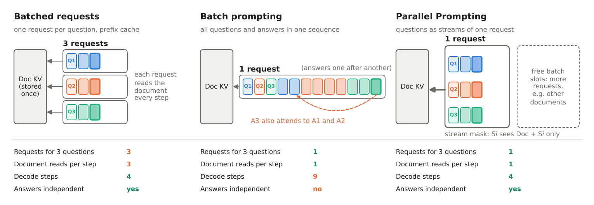

# Read Once, Answer Many: Parallel Prompting for Shared-Context LLM Inference

Zekun Zhao, Jeffrey Flanigan · University of California, Santa Cruz

[Paper](#citation) · [Project page](https://jlab-nlp.github.io/parallel-prompting/)

When many independent questions are asked about the same long document, prefix
caching stores the document's KV cache once, but every decode step still reads it
once per question. **Parallel Prompting (PP)** decodes P questions as P *streams* of a
single request, so each step reads the document once for all of them. A stream-id
mask, evaluated inside SGLang's Triton attention kernel, keeps every answer
conditioned only on the document and its own question.



This repository implements PP in [SGLang](https://github.com/sgl-project/sglang)
**v0.5.22** and **v0.4.2.post3**. It edits three SGLang files (about 80 lines) and adds
a small engine package.

## Results

CodeLlama-7B-Instruct, 8k–16k-token documents, 64–256 questions per document,
128 output tokens. Speedup is the paired geometric mean over 36 runs per setting,
with a 95% bootstrap CI (paper Figure 3). PP is faster in all 144 runs.

| SGLang · GPU | vs. stock FlashInfer + CUDA graphs | vs. stock Triton + CUDA graphs |
|---|---|---|
| 0.4.2 · A100-80GB | 3.68× [3.43, 3.94] | 7.54× [6.99, 8.15] |
| 0.5.22 · A100-80GB | 3.74× [3.48, 4.02] | 5.12× [4.75, 5.53] |
| 0.4.2 · RTX A6000 | 5.96× [5.47, 6.53] | 6.52× [5.99, 7.12] |
| 0.5.22 · RTX A6000 | 5.91× [5.41, 6.48] | 5.65× [5.21, 6.15] |

On real benchmarks (Qwen2.5-7B-Instruct, A100, Table 3), PP answers all 2,086 QuALITY
questions 1.81× faster than stock SGLang, with accuracy within 0.33 points. On LooGLE, whose
answers are long, it is 1.12× faster than stock Triton but slower than stock
FlashInfer. With continuous batching (`ContinuousPPEngine`, Table 4), PP is 1.22×
faster when answer lengths in a batch differ.

## Install

PP is installed on top of the official SGLang Docker image for each version:

```bash
git clone https://github.com/jlab-nlp/parallel-prompting.git && cd parallel-prompting
docker run --gpus all -it --shm-size 8g -v $PWD:/work -w /work lmsysorg/sglang:v0.5.22 bash
bash install.sh 0.5.22   # copies sglang-0.5.22/overlay onto the image's SGLang
```

For v0.4.2, use the `lmsysorg/sglang:v0.4.2.post3-cu124` image and
`bash install.sh 0.4.2.post3`. `install.sh` refuses to overwrite files that are not
stock SGLang.

## Usage

```python
from sglang.srt.server_args import ServerArgs
from sglang.srt.parallel_prompt.engine import ParallelPromptEngine

args = ServerArgs(model_path="codellama/CodeLlama-7b-Instruct-hf", attention_backend="triton",
                  sampling_backend="pytorch", disable_cuda_graph=True, disable_radix_cache=True)
engine = ParallelPromptEngine(args, cuda_graph=True)  # prefix_cache=True: SGLang's radix cache
tok = engine.tokenizer

doc = tok.encode("Read the passage and answer briefly.\n\nPassage:\n...\n\n")
qs = [tok.encode(q, add_special_tokens=False)
      for q in ["Question: Who ...?\nAnswer:", "Question: When ...?\nAnswer:"]]
out = engine.generate([doc], [qs], max_new_tokens=64,
                      stop_token_ids=engine.default_stop_ids(), parallel_size=2)
print([tok.decode(a) for a in out[0]])  # out[document][question] -> token ids
```

`ContinuousPPEngine` (`sglang.srt.parallel_prompt.continuous`, v0.5.22) has the same
interface and refills the batch as requests finish.

A demo that generates a long document and 256 questions, then answers them with PP and
with stock SGLang:

```bash
cd sglang-0.5.22
python3 pp_bench/demo_gen.py --doc-tokens 12000 --num-questions 256 --answer-tokens 32 \
    --parallel-size 32 --cuda-graph --compare
```

## Reproducing the paper

Run from `sglang-0.5.22/` or `sglang-0.4.2.post3/` inside that version's image, after
`install.sh`. Download the haystack text for the synthetic documents first
(`bash scripts/get_data.sh`). All sweeps are resumable. Our raw outputs are in
[`results/`](results/) ([`results/README.md`](results/README.md)).

| Paper | Command | Results |
|---|---|---|
| §4 kernel check | `python3 pp_bench/check_kernel.py` | `sglang-0.5.22_models/*/check_kernel.log` |
| §5.2 Figure 3, Table 2 (0.4.2 · A100) | `bash pp_bench/run_sweep_long.sh <out> A`, then `B` | `sglang-0.4.2_a100/` |
| §5.2–5.4 Figures 3–5 (other settings) | `bash pp_bench/run_figs.sh <out>`, then `run_figs_fix.sh <out>` | `sglang-*_a6000/`, `sglang-0.5.22_a100/` |
| §5.5 Table 3 (QuALITY, LooGLE) | `bash pp_bench/run_bench.sh <out> a100 32768 Qwen/Qwen2.5-7B-Instruct` | `sglang-0.5.22_a100_real/` |
| §5.5 Table 4 (continuous batching) | `bash pp_bench/run_cb_study.sh <out> a6000 Qwen/Qwen2.5-7B-Instruct` | `sglang-0.5.22_a6000_cb/` |
| §5.6 Table 5 (other models) | `bash pp_bench/run_models_0522.sh <out> <hf model> [doc tokens]` | `sglang-0.5.22_models/` |
| Appendix A, Figure 6 (documents per batch) | part of `run_figs.sh` | `sglang-*_a6000/groups_*` |
| Appendix B, Table 7 (SQuAD) | `python3 pp_bench/eval_squad.py --out <out>` | `sglang-0.5.22_a6000_squad/` |

Summaries: `python3 pp_bench/make_stats.py <out>/results.jsonl` (paired speedups,
CIs, sign test), `python3 pp_bench/make_qa_table.py <out>` (Tables 3–4) and
`python3 paper_figs/make_figs.py` (figures from `results/`). Timings depend on the GPU;
expect similar ratios rather than identical seconds.

Checks: `pp_bench/test_mask.py` and `pp_bench/test_cb_mock.py` run on CPU;
`pp_bench/check_equivalence.py` compares PP's answers with stock SGLang's on a GPU.

## Code

| Path (under `sglang-0.5.22/`) | What it is |
|---|---|
| `overlay/sglang/srt/parallel_prompt/mask.py` | stream layout and the reference mask |
| `overlay/sglang/srt/parallel_prompt/engine.py` | the PP engine: document prefill, requests of P streams, CUDA-graph decode steps |
| `overlay/sglang/srt/parallel_prompt/continuous.py` | the engine with continuous batching |
| `patches/*.diff` | the three edited SGLang files, as diffs: the Triton extend kernel (stream-id mask), the attention backend and the logits processor |
| `pp_bench/` | benchmarks, checks and demos |

`sglang-0.4.2.post3/` has the same structure (no prefix cache or continuous batching).

## Limitations

PP is an offline engine that drives SGLang's `ModelRunner` directly, not its scheduler
or server. It supports the Triton backend, page size 1, one GPU and greedy decoding.
Its gain shrinks for long answers, because each stream scans its sibling streams'
answer tokens.

## Citation

```bibtex
@misc{zhao2026readonce,
  title  = {Read Once, Answer Many: Parallel Prompting for Shared-Context {LLM} Inference},
  author = {Zekun Zhao and Jeffrey Flanigan},
  year   = {2026},
}
```

## License

Apache 2.0, as SGLang ([`LICENSE`](LICENSE)). The edited files in `overlay/` outside
`parallel_prompt/` are modified copies of SGLang source files.
